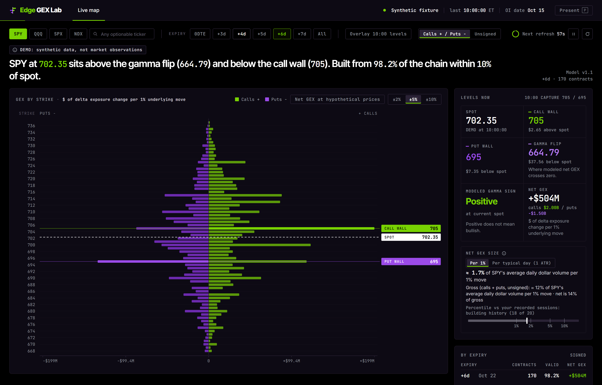
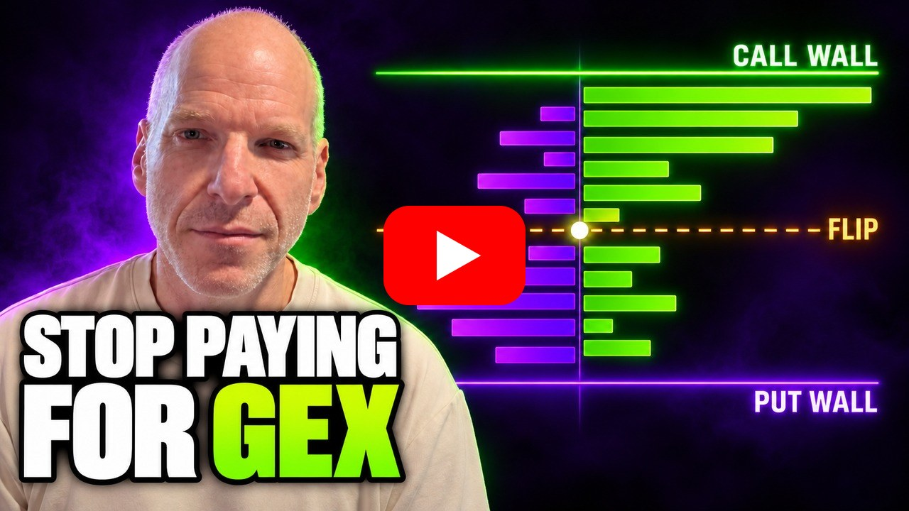
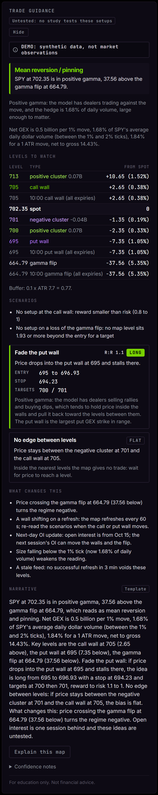

# Edge GEX Lab

[](https://github.com/simonro/Edge-GEX-Lab/actions/workflows/ci.yml)
[](https://github.com/simonro/Edge-GEX-Lab/releases/latest)
[](LICENSE)

A local live map of modeled option gamma exposure (GEX) by strike for crypto options (BTC, ETH, SOL, TRX, SUI, EGLD on
Deribit, OKX, Bybit and Binance). It shows the call wall, the put wall, every gamma flip, the regime at spot, how big
net GEX is next to the coin's own daily dollar volume, and a trade guidance panel that turns the map
into levels and scenarios with every number traceable to the map. Built for active traders who want to
see where option gamma sits without paying for a GEX service.

- **Runs on your computer.** No account, no telemetry, the server listens on `127.0.0.1` only. The
  only call home is a once-a-day check for a new release, and you can turn it off.
- **Every number is shown with how it was made.** OI date and source, feed, valuation time, coverage
  and the sign assumption are on the map, not in a footnote.
- **AI is optional and fenced.** The guidance is a deterministic template. "Explain this map" can ask
  your local `claude` CLI for a narrative; a validator rejects any number or promise not in the data.
- **No keys, no account.** Public exchange REST endpoints only: no websocket, no order endpoint.
- **Free and MIT licensed.** No paid tier.

**[Quick start](#quick-start)** · **[Releases](https://github.com/simonro/Edge-GEX-Lab/releases)** · **[Privacy](#privacy-and-your-data)**

**What this is not:** Not financial advice. Not a signal service. The trade guidance is the textbook
dealer-gamma reading of a model, untested, and says so on screen. Every screenshot below is synthetic
demo data, not live market data.



[](https://youtu.be/okQVLf2s3GI)

**[I Built a Free Gamma Exposure (GEX) Map You Can Understand](https://youtu.be/okQVLf2s3GI)**: what GEX
is and how traders use it, then the tool itself on demo data.

## Structure and second-order exposures

Shown in the map's drawer and as price lines on the Terminal chart. Display only: no capture gate and no guidance scenario reads them.

- **VEX (vanna) and CEX (charm)**: dollars of dealer delta per +1 volatility point and per calendar day, with the same dealer-sign assumption, IV and clock as GEX.
- **Max pain** per expiry (no open interest, no answer), **put/call ratio** on open interest, and the **points of control** (largest net |GEX|, most open interest).
- **Expected move**: 1 sigma = F x ATM IV x sqrt(T) on the nearest expiry with a day or more left, and the **25-delta risk reversal** on that expiry.
- **Cumulative-GEX zero cross**: a cruder cross-check of the swept gamma flip.

The formulas are in `gexlab/engine/structure.py` and `gexlab/engine/bsm.py` (vanna and charm are tested against finite differences). `/api/map` returns them under `structure`.

## Privacy and your data

Edge GEX Lab runs on your own computer. It needs no account, sends no telemetry, and the server
listens on `127.0.0.1` only.

### What stays local

- Small caches (daily bars) and the app's SQLite file in `data/`, which is not part of the repo.

### External services

**Crypto venues** (public REST, no account, no key): Deribit, OKX, Bybit and Binance for option quotes, open
interest and the index price; OKX also for candles. They receive the coin you open and your IP address. The
app calls no trading endpoint and never opens a websocket.

**Your local `claude` CLI** (optional): only when you press "Explain this map". It receives the
guidance object for that map and nothing else, runs with every tool, MCP server and setting disabled,
and gets no API key from this app.

**GitHub** (update check): when the server starts, at most once a day, it asks `api.github.com` for
this repo's latest release. GitHub sees your IP address and the app version, nothing else: no keys, no
tickers, no settings. If a newer version exists, a banner on the page and a line in the `launch.bat`
window link to the release notes; nothing is downloaded or installed. It is silent when you are
offline, demo mode never checks, and `set GEXLAB_NO_UPDATE_CHECK=1` before `launch.bat` turns it off.

### API keys

The app needs no API keys. Do not share or commit caches or screenshots with your account details.

## What's inside

- **Live map**: net GEX by strike (signed, or unsigned by size), the call and put walls, every gamma
  flip within 10% of spot, a hypothetical net GEX curve, an expiry picker (opens on the nearest expiry),
  refreshed every 60 seconds. Tickers you
  search stay as one-click chips beside the search box (the last 6, kept in your browser).
- **Net GEX size**: net and gross GEX per 1% move and per typical day (14-session ATR), as a share of
  the coin's 20-day average dollar volume (Deribit perpetual).
- **Trade guidance**: the environment (trend in negative gamma, mean reversion in positive gamma, mixed
  when influence is low), levels to watch with distance from spot, 2 to 4 scenarios with entry, stop
  and map-level targets (reward at least equal to risk), what would change the picture, and the
  formula behind every computed price. No setups on a stale feed, old open interest, or a chain
  missing too much of its gamma.
- **Coverage you can see**: the share of the estimated |GEX| within 5% of spot held by contracts with
  usable open interest and IV, and how many contracts were left out and why.
- **Vol drift and DEX**: whether at-the-money implied volatility is rising or falling since the session
  began, and the size of call and put delta exposure from open interest. Context only, labeled
  untested. See [Vol drift and DEX](#vol-drift-and-dex).
- **Present mode** (key P): a larger layout for screen recording.

## Crypto: BTC, ETH, SOL, TRX (Deribit + OKX + Bybit + Binance)

The same engine runs on crypto options, with no keys and no account. Open the app and it starts on BTC.

| Coin | Deribit | OKX | Note |
|---|---|---|---|
| BTC, ETH | yes | yes | Books are merged into one map (plus Bybit, below). |
| SOL, TRX | yes (USDC-margined) | no | Thin markets: few, illiquid options. The map says so; read the levels as rough. |
| SUI, EGLD | no | no | Checked live on Deribit and OKX: no options. Bybit is asked too and may list them. The API answers 404 with a clear message; nothing is invented. |

- **Bybit (third venue).** Public REST, one request per coin. Written from Bybit's v5 documentation and unit-tested on a
  payload in the documented shape, but **not yet verified against the live API** (Bybit blocks the cloud sandbox it was
  built in). The map warns about this. Run `python tools/check_bybit.py` on your machine to confirm units (open interest
  in coins, IV as a fraction). If Bybit is unreachable the map is built from the others with a "Partial map" warning.
- **Binance (fourth venue).** Public European Options REST (`eapi.binance.com`, no key): one `/mark` call for every contract, one
  `/index` call and one `/openInterest` call per expiry. Binance lists options only for a few coins (BTC, ETH, SOL, BNB, XRP, DOGE), so
  here it adds BTC, ETH and SOL; the other coins get "no options" from it. It gives no per-expiry forward, so its contracts use
  spot, and its own gamma is ignored: the engine recomputes Black-76 gamma from Binance's mark IV like for every other venue.
  Like Bybit it is written from the documentation, unit-tested on a payload in the documented shape and **not yet verified against
  the live API** (Binance answers the cloud sandbox with HTTP 451). The map warns about this. Run `python tools/check_binance.py`
  on your machine to confirm units (open interest in coins, IV as a fraction). Idea and endpoints from the public
  `sfdcShrikant/crypto-gamma-dashboard` (MIT).
- **Sources.** Deribit, OKX, Bybit and Binance public REST (one request set each, run in parallel). Open interest is live, converted to
  coin units on every venue (OKX contracts x contract size), so strikes from both venues add up in one unit. IV is each
  venue's own mark IV. Spot is Deribit's index (OKX's if Deribit is down); a warning appears if the two differ by more
  than 0.5%.
- **If one venue fails** the map is built from the other and says "Partial map" in the warnings; the feed bar shows each
  venue's status and its share of |GEX|. If every venue fails the API answers 503.
- **Black-76 on each expiry's forward.** Every expiry has its own forward (the venue's own), so gamma and the dollar scale
  use it instead of spot: GEX = sign x N'(d1) / (F x IV x sqrt(T)) x OI x F^2 x 0.01. With F equal to spot this is
  exactly the equity formula.
- **24/7 clock.** Every option settles at 08:00 UTC on its expiry date. Times on screen are UTC. Contracts with less than
  1 hour to settlement are left out.
- **Wider bands.** Zero-gamma sweep, walls, displayed strikes and coverage use +-20% of spot (equities: 10%); the
  coverage gate uses +-10%. The expiry window is 0 to 180 days. Low-priced coins (TRX 0.30) use a rounded sweep step and
  per-coin price decimals.
- **Size reference.** Net GEX is compared with Deribit's perpetual daily dollar volume and 14-day ATR. One venue only, so
  shares of volume read larger than against all volume; the per typical day (1 ATR) view is the fairer comparison.
- **What is not there yet.** CME options are not included (named in the map's warnings). Vol drift,
  frozen captures and the percentile history are not available for crypto.
- **Caveats.** The sign assumption (calls +, puts -) is weaker in crypto, where covered-call vaults and risk reversals are
  common: the unsigned view drops it. Not financial advice.

`GEXLAB_DEMO=1` serves recorded Deribit/OKX snapshots, labeled as such. Refresh them with
`python tools/snapshot_crypto.py`.

## Terminal screen (crypto)

Second screen next to the Live map (`#/terminal`): OKX swap candles (5m to 1D) with the map's call wall, put wall and
gamma flip drawn as price lines, a **MultiMap** ladder (strike, net GEX per 1%, CW/PW/FLIP tags, spot row) for two coins side
by side, and Levels / Sources tabs. It reads the same `/api/map` as the Live map plus a new `/api/candles` (crypto only,
OKX public, 20 s cache; demo mode serves recorded candles). The strip under the chart is the modeled dealer hedge flow per price step around spot (green buy, purple sell; a linear model from the map's profile curve, not a measured flow). Not there yet: expected-range cone, replay.

### History, per-candle flow and replay

While the app runs live it saves each crypto coin's GEX map every 5 minutes (`gexlab/history.py`, table `crypto_snaps` in
`data/gexlab.db`, about 5 MB a day, kept 14 days). From those snapshots the Terminal draws:

- **Hedge flow per candle:** the modeled hedge for each candle's realized move (open to close) along the profile curve of the
  snapshot nearest to that candle. Green dealers buy, purple sell. A model, not a measured flow.
- **Wall history:** call and put walls as step lines on the candles.
- **Replay:** a slider over the stored snapshots; the ladder, levels, sources and hedge strip show that moment, with a marker on
  the candle.

History starts the day recording starts: venues' public APIs give no open-interest history, so nothing is back-filled or
invented, and candles with no snapshot stay empty. `GEXLAB_RECORD=0` turns recording off, `GEXLAB_RECORD_EVERY_S` changes the
period, `GEXLAB_SNAP_DAYS` the retention. `python -m gexlab.history` stores one snapshot now. Demo mode never records.

## Screenshots

**Live map.** GEX by strike around spot, with the walls and the gamma flip marked and the method
drawer one click away. Synthetic demo data.


**Trade guidance.** Levels to watch, scenarios with entry, stop and targets, and the regime change
triggers, each price traceable to the map. Synthetic demo data. For education only, not financial
advice.



## Quick start

Requirements: [Python 3.11 or newer](https://www.python.org/downloads/), [Node.js LTS](https://nodejs.org/),
No account or API keys.

**Windows, two steps:** download or clone the repo, then double-click

1. `setup.bat`, once. It installs everything and builds the web page.
2. `launch.bat`, every time. It opens http://127.0.0.1:8240.

**Try it first with no network:** `launch.bat demo` (or set `GEXLAB_DEMO=1` before
starting the server) serves recorded crypto snapshots (and synthetic equity fixtures the engine tests use). Every screen carries a
"Synthetic fixture" badge, nothing in it is market data, and it writes only to `data/gexlab_demo.db`,
so your real install stays empty. Close the window and run `launch.bat` to switch to your own data.

**Manual setup (Mac, Linux, or if you prefer):**

```bash
python -m venv .venv
.venv/bin/python -m pip install -r requirements.txt     # Windows: .venv\Scripts\python
cd web && npm ci && npm run build && cd ..
.venv/bin/python -m uvicorn gexlab.api:app --host 127.0.0.1 --port 8240
```

**Install with an AI coding assistant:** if you use one (Claude Code, Codex, Cursor or similar), open it
in an empty folder and paste this prompt:

```text
Install Edge GEX Lab on this computer from github.com/simonro/Edge-GEX-Lab. Follow the README Quick start
exactly. First check that Python 3.11+ and Node.js LTS are installed, and if one is missing, tell me
instead of installing it. Then run the setup, start the app and confirm http://127.0.0.1:8240 opens.
Do not add any API keys; the app needs none.
```

Every install starts empty: no saved maps and no history. Open the page, pick a coin, and the map
loads from the venues' public APIs.

**If the web build fails on Windows** with "An Application Control policy has blocked this file":
that is Smart App Control blocking a native build helper. The project builds with the WebAssembly
version of Rollup to avoid it, so delete `web\node_modules` and run `setup.bat` again.

## Updating to a new release

Your caches and history (`data/`) are not part of a release, so an update never touches them.
When a new release is out, the app tells you with a banner at the top of the page (once a day, see
Privacy above), linking to its release notes.

**If you cloned with git:** `git pull`, then `setup.bat` (it rebuilds the page), then `launch.bat`.

**If you downloaded the ZIP:** unzip the new version into a new folder, copy `data/` across, run
`setup.bat` once, then `launch.bat`.

## Configuration

| Variable | Enables |
|---|---|
| `GEXLAB_PORT` (environment variable, not `.env`) | Port for `launch.bat` and the web dev server's proxy, 8240 by default. Example: `set GEXLAB_PORT=8250` then `launch.bat`. For the manual start, pass the same number to `--port`. |
| `GEXLAB_NO_BROWSER` (environment variable, not `.env`) | `1` stops `launch.bat` from opening your browser. |
| `GEXLAB_NO_UPDATE_CHECK` (environment variable, not `.env`) | `1` turns off the once-a-day check for a new release on GitHub. |
| `GEXLAB_DEMO` (environment variable, not `.env`) | `1` serves the synthetic demo fixtures, the same as `launch.bat demo`. |
| `GEXLAB_RECAP_MODEL` (environment variable, not `.env`) | Optional model name passed to your `claude` CLI for "Explain this map". |

## How it works

- **GEX per contract** = sign x gamma x open interest x 100 x spot squared x 0.01: dollars of dealer
  delta change per 1% move. Gamma is Black-Scholes with r = q = 0, a stated approximation.
- **The sign is an assumption.** Calls count as positive gamma and puts as negative (dealers long
  calls, short puts). Real positioning is not public; the unsigned view drops the assumption.
- **Open interest is live** on every crypto venue, converted to coin units (OKX contracts x contract size),
  so strikes from several venues add up in one unit. The OI date on the map is the snapshot time.
- **Feeds.** Each venue's own mark IV is used; the map labels which venues contributed and shows each venue's
  status and share of |GEX|.
- **Valuation clock.** Time to expiry is measured from the quote time, and from the session close when
  the market is shut, so a weekend map is not distorted.

## Vol drift and DEX

Two context readings on the Live Map. Neither changes the GEX math, the levels or the guidance, and
neither is tested: both carry an **Untested** chip.

- **Vol drift** answers one question: is at-the-money implied volatility rising or falling today? It
  reads the ATM IV of one expiry (the IVs of the two strikes around spot, interpolated to spot) and
  compares it with the session's first reading after the open. The expiry is the nearest one with at
  least 3 full trading days left, fixed for the whole session and never 0DTE, so the reference and the
  current value measure the same contracts. The change counts as flat while it is smaller than
  max(0.5 vol points, 5% of the reference IV); beyond that it reads rising or falling. The card pairs it
  with the gamma regime as the conditions where moves tend to get bigger (rising IV in negative gamma)
  or stay smaller (falling IV in positive gamma). A ticker that lists only Friday expiries can read
  unavailable late in the week, when no expiry in the 7 day window has 3 full sessions left.
- **DEX** is delta exposure: delta x open interest x 100 x spot, summed per side. Net DEX is call delta
  exposure minus put delta exposure, so it reads positive when calls are larger and negative when puts
  are, with each side's size shown unsigned. Open interest is the previous session's, so DEX sizes
  yesterday's positioning at today's price and IV. It is not a live flow scoreboard.

Not financial advice.

## Contributing

Bug reports and pull requests are welcome. [CONTRIBUTING.md](CONTRIBUTING.md) covers setup, tests and
what a change needs. Please report security problems privately, as described in
[SECURITY.md](SECURITY.md), not in a public issue.

## More free tools from Tape to Edge

Same rules for each one: free, MIT, runs on your own machine, and the build is on the [YouTube channel](https://www.youtube.com/@tapetoedge).

- [Edge Scanner](https://github.com/simonro/edge-scanner): a real-time intraday stock scanner with a browser dashboard you lay out yourself.
- [Trading Journal AI](https://github.com/simonro/Trading-Journal-AI): a local-first journal. Import your broker CSV, get round-trip trades, KPIs and AI diary analysis.
- [AI Research Desk](https://github.com/simonro/ai-research-desk): three AI research teams debate one stock into swing and long-term calls.

## Who made this

I'm Simon, a trader who builds his own tools and films the process on Tape to Edge. This is the live
map from my GEX research lab; the evidence side (frozen 10:00 levels, replays and pre-registered
studies of whether the levels matter) stays private until it has enough sessions to say something.

- YouTube: [@tapetoedge](https://www.youtube.com/@tapetoedge)
- X: [@tapetoedge](https://x.com/tapetoedge)

I take no affiliate money from any tool I show, and this project has no paid tier, no account and
no telemetry. If it is useful, fork it.

## License

MIT. See [LICENSE](LICENSE). Charts use TradingView Lightweight Charts (Apache 2.0).

## Local price history (automatic download)

When the app starts live it downloads OKX swap candles for every crypto coin (BTC, ETH, SOL, TRX, SUI, EGLD) and keeps them in the app's SQLite file (table `ohlcv`):

| Timeframe | Depth |
|---|---|
| 5m | 14 days |
| 15m | 60 days |
| 1H | 365 days |
| 4H | 730 days |
| 1D | 1095 days |

- Runs in a background thread, about 8 minutes the first time; later starts only fetch what is missing, and it tops up hourly.
- Only confirmed bars are stored. A young coin simply has a shorter series.
- `/api/candles` serves local history behind the latest bars (limit up to 2000). `/api/history/backfill` reports progress; the Terminal screen shows it.
- `GEXLAB_HISTORY=0` disables it, `GEXLAB_HISTORY_PACE_S` sets the pause between requests (0.15 s). Run it by hand with `python -m gexlab.ohlcv`.
- This is price only. Options open interest has no public history, so the GEX history is what `gexlab.history` records from now on.
